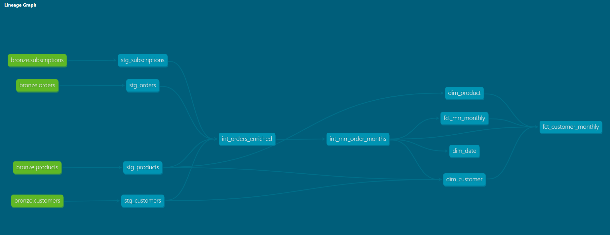

# Unified Revenue & Product Performance Model

## 1. Overview

A single, tested data model that gives the Director of Revenue one version of the truth on recurring revenue:
how MRR grows and why (new, expansion, reactivation, contraction, churn), how each product category performs,
and how well customers are retained, churn and buy across categories.

All figures cover the reporting window **January 2019 – November 2022** (47 month-ends) and are in EUR.

## 2. Architecture



| Layer | Schema | What it does |
|---|---|---|
| Bronze | `workspace.bronze` | Raw CSV extracts loaded as text, unchanged (`setup/01_load_bronze.sql`). |
| Silver | `workspace.silver` | Staging views clean and type each source and flag bad rows; intermediate tables apply the MRR rules and spread every order over the month-ends it is active. |
| Gold | `workspace.gold` | Star schema (dimensions + facts) and report tables with the KPIs, ready for Power BI. |

**Tools:** dbt Core 1.12 with dbt-databricks 1.13 and `dbt_utils`; Databricks Free Edition (Unity Catalog, Delta);
Power BI Desktop in Import mode.

## 3. How to run

1. **Load Bronze.** Upload the four CSV files to the volume `/Volumes/workspace/bronze/raw_files/` and run
   `setup/01_load_bronze.sql` in the Databricks SQL editor. Expected rows: customers 92,042, orders 210,000,
   subscriptions 170,245, products 1,462.
2. **Install dbt.** From the folder above the project:
   ```
   python -m venv .venv
   .venv\Scripts\activate
   pip install dbt-databricks==1.13.0
   ```
3. **Connect.** Create `~/.dbt/profiles.yml` (never committed):
   ```yaml
   teamblue_revenue:
     target: dev
     outputs:
       dev:
         type: databricks
         catalog: workspace
         schema: silver
         host: <workspace-host>.cloud.databricks.com
         http_path: /sql/1.0/warehouses/<warehouse-id>
         token: "{{ env_var('DATABRICKS_TOKEN') }}"
         threads: 4
   ```
4. **Build and test.** From `teamblue_revenue/`:
   ```
   dbt deps
   dbt debug
   dbt build
   ```
   Expected result: 12 models and 156 tests, `PASS=167 WARN=1 ERROR=0`. The one warning is expected: 4 orders
   reference a subscription that is not in the subscriptions file (kept and flagged).
5. **Documentation.** `dbt docs generate` and `dbt docs serve` show every model, column and test.
6. **Dashboard.** Open `powerbi/teamblue_revenue.pbix` and point the Databricks connection to your workspace.

## 4. Data product definition

| Table | Grain (one row =) | Purpose | Rows |
|---|---|---|---|
| `dim_customer` | customer | Country, segment, join date, first paid month | 92,042 |
| `dim_product` | product | Name, subcategory, category | 1,462 |
| `dim_date` | month-end | Calendar, `is_reporting_month` flag | 218 |
| `fct_mrr_monthly` | customer × product × month-end | Paid MRR per product | 1,213,973 |
| `fct_customer_monthly` | customer × month-end | MRR, movement type, bridge amounts, active / new logo / churn / cross-sell flags | 1,026,018 |
| `rpt_kpi_monthly` | reporting month | The 10 KPIs, the MRR bridge, revenue churn, categories per customer | 47 |
| `rpt_category_monthly` | category × reporting month | Category MRR, active customers, revenue churn rate | 188 |
| `rpt_cohort_retention` | cohort × months since start (0, 1, 3, 6, 12, 24) | Customer and MRR retention of new-logo cohorts | 276 |

**Why this structure**
- **Star schema.** Dimensions describe who, what and when; facts hold measures at one fixed grain, so every
  slice (country, segment, category, month) adds up correctly.
- **Business logic lives once, in the facts.** MRR, movements and flags are computed in dbt and tested; the
  `rpt_` tables only aggregate. KPI definitions therefore live in version-controlled SQL, not in BI visuals, and
  every report shows the same number.
- **Cohort retention is separate** because its grain (cohort × months since start) is not a calendar month.

## 5. KPI framework

| # | KPI | Definition | What it says about business health |
|---|---|---|---|
| 1 | MRR | Recurring revenue at month-end (price ÷ duration) | Size of the recurring base |
| 2 | MRR growth YoY % | MRR vs the same month a year earlier | Growth pace without seasonality |
| 3 | Net new MRR | New + expansion + reactivation − contraction − churn | Why MRR moved |
| 4 | Net revenue retention | Today's MRR of customers paying 12 months ago ÷ their MRR then | Whether the base grows on its own |
| 5 | Gross revenue retention | As NRR, each customer capped at their old MRR | Revenue kept, without upsell |
| 6 | Customer churn rate | Churned customers ÷ active customers last month | Customer health |
| 7 | Active customers | Customers with a paid recurring order running at month-end | Reach of the base |
| 8 | New logos | First paid month, joined within the last 12 months | True acquisition |
| 9 | ARPU | MRR ÷ active customers | Pricing power and mix |
| 10 | Cross-sell rate | Active customers paying in 2+ product categories | Depth of the relationship |

Formulas, healthy trends, supporting measures (revenue churn rate, categories per customer) and cohort
retention are described in [docs/kpi_framework.md](docs/kpi_framework.md).

## 6. Insights memo

### a) Data quality

Rows are flagged rather than deleted, so every number reconciles to Bronze; total paid revenue is
€3,615,275.33 at every layer ([docs/validation_report.md](docs/validation_report.md)).

| Issue | Count | Handling |
|---|---|---|
| Exact duplicate orders | 10,011 | Removed (210,000 → 199,989); the only rows deleted |
| Refunds (negative price) | 1,661 lines (1,611 recurring) | Flagged `is_credit` and excluded from MRR. Not netted: only 121 of 1,611 match an original order by renewal code, customer and product |
| Free bundled items (0.01 €) | 66,644 lines | Kept with MRR 0; they never make a customer active |
| One-off fees (`flag_recurring = 0`) | 2,299 lines | Excluded from MRR |
| Invalid dates / durations | 129 / 78 lines | Excluded and flagged; 21 zero durations derived from the dates |
| Internal accounts (Registry, `-EUROMNT`) | 36 accounts, 22,182 lines | Excluded from MRR and customer KPIs (about €1.9k MRR per month) |
| Malformed product rows | 1 row (product 164202) + broken header | Repaired in staging; quotes and trailing commas stripped |
| Unknown subscription id | 4 orders | Kept and flagged (the one test warning) |

- **Reporting window 2019-01 to 2022-11.** The extract only holds periods expiring 2019–2023. Months before
  2019 miss expired periods (MRR ramp-up); from December 2022 renewals expiring after 2023 are missing (run-off).
- **Subscription status is not used for MRR.** It is a current snapshot without a change date, its expiry
  dates reflect today's state (up to 2036), and 72% of statuses are empty. Orders are the source of truth.
- **Source oddities** without effect on the KPIs (e.g. 64 customers who joined after their first paid month)
  are listed in the validation report.

**Key finding: renewal orders are missing across the whole extract.** Of new customers on 12-month products who
started between mid-2019 and mid-2021, only about 11% have an order around their renewal date, while the
subscriptions file shows about 78% of those subscriptions were extended by at least a year. A customer whose
renewal order is missing looks churned. Customer churn is therefore strongly overstated, and NRR, GRR and
cohort retention from month 12 strongly understated, in every month. **Use these KPIs for comparisons between
periods, categories and cohorts, not as absolute levels.**

### b) Active and churn definitions

- **Active customer:** in a given month, the customer has at least one paid recurring order running at month end.
  Free bundled items (0.01 €) don't count.
- **Churned customer:** a customer who was active last month and is not active this month. In practice, all of
  their paid recurring orders expired and no renewal order followed.

Churn is measured per customer: dropping one product while keeping another is contraction, not churn. Category
churn is measured per customer × category. A customer who returns later is a reactivation. There is no grace
period: only 1.9% of churn events (935 of 47,991) return within one month, so a grace period would barely change
the rate while breaking the link between the churn KPI and the MRR bridge.

### c) Scaling from 200k to 200M rows

- **Warehouse:** a cloud warehouse (Databricks SQL, BigQuery or Snowflake) with separate compute for loading and BI.
- **Incremental models:** order spreads and monthly facts as incremental dbt models processed by month, so a
  run only rebuilds the latest months.
- **Layout:** partition facts by `month_end_date` and cluster by `customer_id`, the keys used by every join and filter.
- **No full cross joins:** month rows are generated only for each order's active period (already the case here),
  never as a full customer × month grid.
- **Materialisation:** staging as views, marts as tables or incremental tables; tests limited to recent
  partitions on daily runs, with a full test run weekly.
- **BI:** Power BI imports only the small `rpt_` tables; drill-downs use DirectQuery on the facts.

### d) Key findings

1. **MRR grew 26% but stalled in 2022.** MRR rose from €51.7k (Jan 2019) to €65.3k (Nov 2022), peaking at €66.1k
   in January 2022. Year-over-year growth was 8.5%, 10.0% and 8.7% at the end of 2019–2021, but only 0.4% in
   November 2022. Net new MRR fell from +€4.3k / +€5.5k / +€5.3k per year to −€0.4k in 2022. Part of this is
   multi-year lines running off: excluding lines longer than 12 months, growth in 2022 is still +4.9%, half the
   earlier pace.
2. **Churn rose in 2022.** Average monthly customer churn was 6.3–6.5% in 2019–2021 and 7.0% in 2022; revenue
   churn rose from about 7.7% to 8.4%. New logos fell from 2,509 (2021) to 1,992 (Jan–Nov 2022). Levels are
   overstated (see a), but the deterioration is consistent.
3. **Growth came from price and mix, not more customers.** ARPU rose 22%, from €3.54 to €4.32, while active
   customers grew only 3% (14,627 to 15,109) and are 9% below their March 2021 peak of 16,533.
4. **Each category plays a different role.** Domains is the largest (50% of MRR), has the lowest revenue churn
   (6.8%) and is the only main category still growing in 2022 (+2.3% YoY). Applications grew fastest (+38.7% since
   January 2019) but declined 2.0% in 2022. Hosting has the highest revenue churn of the main categories (11.1% a
   month).
5. **Cross-sell is flat.** Only about 7% of active customers pay in two or more categories (7.2% in November
   2022, between 7.1% and 8.2% throughout), with 1.09 categories per customer on average.

## 7. Repository structure

```
teamblue_revenue/
├── setup/01_load_bronze.sql      Load raw CSVs into Bronze
├── models/
│   ├── staging/                  stg_ views: typing, cleaning, flags
│   ├── intermediate/             int_ tables: MRR rules, order × month-end spread
│   └── marts/                    Gold: dim_, fct_, rpt_ tables and their tests
├── tests/                        Reconciliation tests (MRR = price, bridge, report vs facts, cohorts)
├── macros/                       Schema naming
├── docs/
│   ├── kpi_framework.md          KPI definitions and how to read them
│   ├── validation_report.md      Bronze-to-Gold reconciliation and source data notes
│   ├── Lineage_graph.png         Model lineage
│   └── exports/                  CSV extracts of the monthly bridge and category tables
├── powerbi/teamblue_revenue.pbix Dashboard
├── dbt_project.yml               Project config and reporting-window variables
└── packages.yml                  dbt_utils
```
